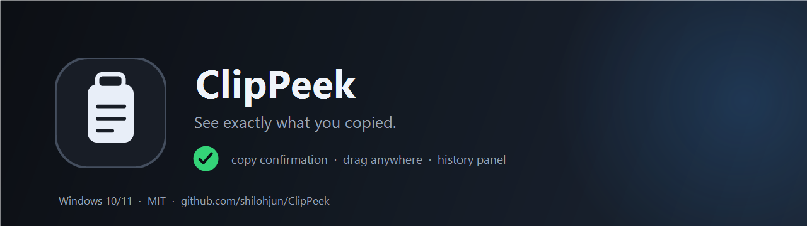
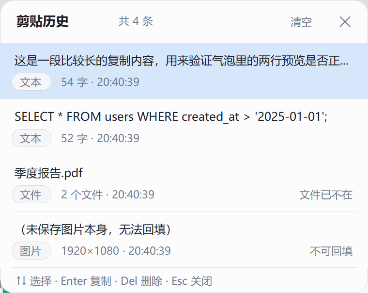
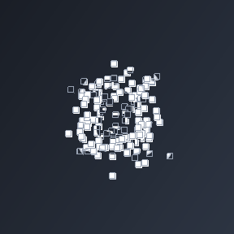
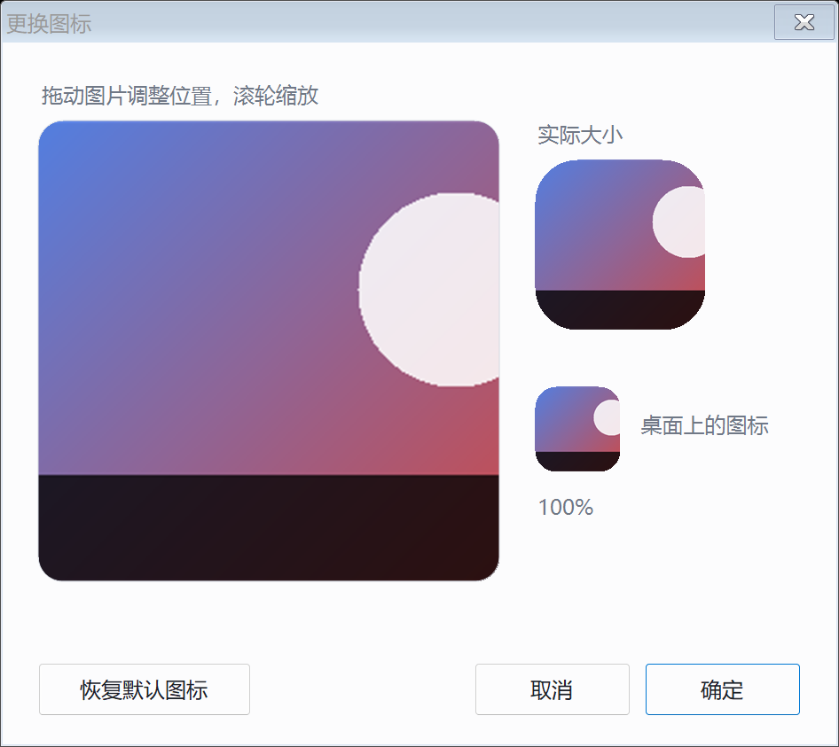

# ClipPeek

<p align="center">
  
</p>

<h2 align="center">ClipPeek</h2>

<p align="center">
  <a href="README.md">中文</a> | <a href="README.en.md">English</a>
</p>

<p align="center">
  
  
  
  
  <a href="https://github.com/shilohjun/ClipPeek/releases"></a>
</p>

> 复制完抬头就能看见：**刚才到底复制成功没有、复制了什么。**

按下 Ctrl+C 之后，你是不是也经常这样：不确定有没有复制上，只好切到别处按一下 Ctrl+V 试试；或者复制了三段东西，回头想不起剪贴板里现在到底是哪一段。

Windows 的剪贴板是**完全没有反馈**的。ClipPeek 就是给这个动作补上反馈和记忆：

- **复制瞬间**：屏幕角落弹出气泡，「已复制 · 文本 · 42 字」+ 两行内容预览；复制图片显示缩略图，复制多个文件显示数量。
- **随时回看**：桌面边上一个可拖动的小图标，单击就展开历史面板，200 条记录，点一条就复制回剪贴板。

一个 57 KB 的单文件程序，不装运行时、不写注册表、不要管理员权限。

---

## 为什么会有这个东西

起因很朴素：在终端里按 Ctrl+C，有时是复制，有时是打断命令；复制了长日志想确认抓到没有，只能靠粘出来看一眼。网上的剪贴板管理器都要求你**先按热键唤出窗口**才知道结果——顺序反了。

ClipPeek 的顺序是反过来的：**复制是主语，反馈是自动的**。你什么都不用做，气泡自己会告诉你结果；历史面板只在你想翻旧账的时候才需要打开。

---

## 它能做什么

| | |
|---|---|
| ✅ **复制确认气泡** | 类型 + 字数/尺寸 + 最多两行预览；2.5 秒自动淡出，鼠标悬停暂停，点气泡直接开历史 |
| ✅ **开场动画** | 启动时 144 个 8px 小方块从四周汇聚成图标，**背景完全透明**（没有卡片，直接浮在你桌面上）；可关、可重播、不挡点击 |
| ✅ **自定义图标** | 右键「更换图标…」选一张图，或直接把图片拖到浮动图标上 → 拖动/滚轮裁成方形 → 浮动图标、托盘图标、开场动画一起换 |
| ✅ **图片缩略图** | 复制截图或图片时气泡里给缩略图，尺寸和体积都标出来 |
| ✅ **可拖动的浮动图标** | 放在哪都行，位置记住；单击开面板、右键出菜单、拖动 4px 才判定为拖动 |
| ✅ **剪贴历史面板** | 最近 200 条，类型标签 + 时间 + 内容首行；单击复制回剪贴板，`Del` 删除，`Esc` 关闭 |
| ✅ **全局热键** | `Ctrl+Alt+V` 随时召出面板，图标被挡住也不影响 |
| ✅ **托盘兜底** | 浮动图标被拖丢 / 被全屏盖住时，托盘图标永远在 |
| ✅ **尊重敏感内容** | 带 Windows「Clipboard Viewer Ignore」标记的内容（密码管理器会打）完全不记录、不弹窗 |
| ✅ **全屏自动让路** | 玩游戏、看全屏视频、演示时自动隐藏，退出全屏 1 秒内回来 |
| ✅ **高分屏清晰** | 声明 DPI 感知，200% 缩放下不糊（不是被系统拉伸的位图） |
| ✅ **深色/浅色跟随** | 读系统主题，面板和气泡自动配 |

---

## 截图

| 历史面板 | 文本气泡 |
|---|---|
|  |  |

| 图片气泡 | 浮动图标 |
|---|---|
|  |  |

| 开场动画（浮块拼装） | 换图标时裁剪 |
|---|---|
|  |  |

---

## 安装

### 方式一：安装包（推荐）

去 [Releases](https://github.com/shilohjun/ClipPeek/releases) 下载 `ClipPeek-Setup-1.0.0.exe`，双击即可。

- 装到 `%LOCALAPPDATA%\Programs\ClipPeek`，**不需要管理员权限**
- 开始菜单快捷方式必建；桌面快捷方式和开机自启是可选项（开机自启默认勾上）
- 卸载走「设置 → 应用 → ClipPeek」，**历史记录不会被删**

### 方式二：免安装便携版

下载 `ClipPeek-1.0.0-portable.zip`，解压到任意目录，双击 `ClipPeek.exe`。

包里有 `portable.txt`，程序会把 `history.json` / `settings.json` 写在 exe 旁边，整个文件夹可以拷进 U 盘带走。

### 方式三：自己编译

见下面「[从源码构建](#从源码构建)」，只需要系统自带的 .NET Framework 编译器。

> ⚠️ **没有代码签名证书**：安装包和 exe 首次运行会触发 SmartScreen 蓝色提示（"Windows 已保护你的电脑"）。点「更多信息」→「仍要运行」即可。介意的话直接看源码编译，全部代码就在这个仓库里。

---

## 用法

| 动作 | 结果 |
|---|---|
| 复制任意内容 | 图标闪一下绿边 + 旁边弹气泡（类型 / 字数 / 预览 / 缩略图） |
| **单击**浮动图标 | 展开 / 收起剪贴历史面板 |
| **拖动**浮动图标 | 挪到任意位置，松手自动记住；下次启动回到原处 |
| **把图片拖到图标上** 或 右键「**更换图标…**」 | 弹出裁剪框：拖动平移、滚轮缩放，确定后浮动图标 / 托盘图标 / 开场动画一起换成你的图 |
| **右键**浮动图标 | 打开历史 / 暂停监听 / 开机自启 / 隐藏图标 / 恢复默认位置 / 打开数据目录 / 更换图标 / 调整图标裁剪 / 恢复默认图标 / 启动时播动画 / 重播动画 / 创建开始菜单快捷方式 / 清空历史 / 退出 |
| 单击托盘图标 | 同「单击浮动图标」（图标丢了时的后备入口） |
| 双击托盘图标 | 把隐藏的浮动图标叫回来 |
| `Ctrl+Alt+V` | 全局热键，随时召出历史面板 |
| `Ctrl+Alt+C` | **程序没在跑**时启动它（需要先在菜单里创建一次开始菜单快捷方式） |

**历史面板里**：`↑` `↓` 选择 · `Enter` 复制回剪贴板 · `Del` 删除 · `Esc` 关闭 · 单击复制 · 右键菜单 · 点面板外面自动收起。面板默认**跟着图标走**（图标拖到哪儿，下次就在哪儿打开）；**只有图标被隐藏时**才能按住面板空白处拖动它，位置会被记住。

**图标隐藏了怎么找回来？** 三条路都行：

1. **双击托盘图标**（托盘右键菜单里也有「显示浮动图标」）
2. 按 `Ctrl+Alt+V` 打开历史面板，点页脚的「**图标已隐藏 · 点这里显示浮动图标**」
3. 下次启动时如果图标仍是隐藏的，会主动弹提示告诉你

隐藏的那一瞬间也会弹气泡说明恢复方式，不用记。

---

## 数据与隐私

| 文件 | 位置 | 内容 |
|---|---|---|
| `history.json` | 安装版：`%APPDATA%\ClipPeek\`<br>便携版：exe 同目录 | 最近 200 条记录 |
| `settings.json` | 同上 | 图标位置、暂停状态、自启开关、是否播开场动画 |
| `custom-icon.png` | 同上 | 你换的自定义图标（256×256 裁好的） |
| `clip-peek.log` | 同上 | **只在出错时**写入，平时不产生 |

**完全本地**：没有任何网络请求、没有账号、没有遥测。所有内容只在你自己的磁盘上。

跳过规则：

- 带「Clipboard Viewer Ignore」标记的内容（1Password、Bitwarden 等密码管理器会打）→ 不记录、不弹窗
- 图片只记录尺寸描述，**不把图片本身写进磁盘**
- 单条文本最多存 **5 万字**：超出部分丢弃并在记录里标「已截断」，气泡照样弹（第二行会写「已截断 · 仅保存前 5 万字」），避免 `history.json` 被几条超长文本撑爆

想彻底删干净：退出程序，删掉数据目录，再删安装目录即可。安装版卸载时故意保留数据目录。

---

## 已知取舍

- **图片不能回填**：历史里只有「1920×1080」这样的描述，点它只会提示「未保存图片本身，无法回填」。换来的是截图不会悄悄堆在磁盘上。
- **文件能真正放回剪贴板**：文件类记录单击会把**真正的文件**放回剪贴板（同时附一份路径文本），资源管理器里能直接粘贴。如果这些文件已经被移动或删除，只能退回「复制路径」，气泡会明确告诉你，面板里那条也会标上「文件已不在」。
- **自定义图标只作用于程序自己**：浮动图标、托盘图标、开场动画会换；开始菜单 / 桌面快捷方式的图标不会跟着变（那需要改 exe 资源）。
- **相同内容会合并**：连续复制同一段文字会合并成一条并把时间刷新到最前，不会把 200 条容量刷成重复项。
- **没有搜索框**：200 条以内的历史靠滚动和类型标签就够了；加搜索会引入输入焦点，和「点面板外面就收起」冲突。
- **注释是中文**：代码注释保持中文，README 提供英文版。

---

## 常见问题

**它没在跑的时候，按 Ctrl+C 为什么一点反应都没有？**
剪贴板监听必须有进程活着，这是机制决定的。让它常驻有两个办法：

1. **开机自启（默认已开）**：登录 Windows 后启动文件夹里的 `ClipPeek.lnk` 会把它拉起来，托盘里就有它。
2. **手动拉起**：右键图标 →「创建开始菜单快捷方式（Ctrl+Alt+C）」，之后即使它没在跑，按 `Ctrl+Alt+C` 也能启动（Windows 快捷方式自带的启动键）。也可以直接在任务栏固定 `ClipPeek.exe`。

**怎么换图标？点错了怎么换回来？**
两种都行：右键图标 →「更换图标…」挑一张图片；或者直接把 PNG / JPG / ICO 拖到浮动图标（或历史面板）上。随后弹出裁剪框，拖动图片平移、滚轮缩放，确定即可。浮动图标、托盘图标、开场动画的小方块会一起换。右键菜单「恢复默认图标」还原，同时删掉 `custom-icon.png`。

**开场动画看不到了 / 想再看一次？**
右键菜单里「启动时播开场动画」控制开关，「重播开场动画」可以立刻再看一遍。它不抢焦点、不吃鼠标点击，点一下面板热键会立即跳过。

**图标不见了？**
先双击托盘图标（或托盘右键 →「显示浮动图标」）。播放全屏视频 / 玩游戏 / 演示时它是故意隐藏的，退出全屏 1 秒内自动回来。

**复制文件后回填，为什么粘出来是一串路径？**
现在不会了：文件类记录单击会把**真正的文件**放回剪贴板（`CF_HDROP`，附一份路径文本兜底），在资源管理器里直接粘贴就是文件。只有当那些文件已经被移动或删除时，才退回只复制路径，并弹气泡提示「文件已不在原处，这次只复制到了路径」。

**某次复制没弹气泡？**
三种可能：内容带了密码管理器的禁止记录标记（完全不记录）、托盘菜单里勾了「暂停监听」、或者剪贴板正被别的程序占用导致这一下没取到。超长文本**不再**吞气泡，只是会被截断并标出来。

**换了分辨率或缩放，图标跑到奇怪的地方？**
右键图标 →「恢复默认位置」。

**双屏？**
图标默认在主屏右侧，可以直接拖到另一块屏上，位置会记住。

**热键和别的软件冲突？**
改 `src/ClipPeekContext.cs` 里 `Native.RegisterHotKey(..., 0x56)` 的 `0x56`（字母 V），重新编译。

**想开机不启动？**
托盘/图标右键菜单里取消勾选「开机自启」，会删掉启动文件夹里的快捷方式。

---

## 从源码构建

只需要 Windows 自带的 .NET Framework 编译器（`csc.exe`），不需要 Visual Studio 或 .NET SDK。

```powershell
# 编译到 dist\ClipPeek.exe
powershell -ExecutionPolicy Bypass -File build.ps1

# 跑自测 + 打便携包 + 打安装包（安装包需要 Inno Setup 6 的 ISCC.exe）
powershell -ExecutionPolicy Bypass -File package.ps1
```

自测会把 10 项检查跑一遍（历史去重、落盘往返、剪贴板捕获、气泡显隐、面板显隐、回填、图片不可回填…），任何一项 FAIL 都会让 `package.ps1` 中止。

素材（图标 / logo / 横幅）不是手画的，是调用程序自己的绘制代码生成：

```powershell
powershell -ExecutionPolicy Bypass -File tools\make-assets.ps1
```

### 版本号

只有一个来源：`installer/version.iss` 里的 `AppVersion`。`package.ps1` 和安装包脚本都读它。

---

## 仓库结构

```
ClipPeek/
├── src/                     C# 源码（C# 5 语法，兼容 .NET Framework 4.x）
│   ├── Program.cs           入口、单实例、命令行参数
│   ├── ClipPeekContext.cs   主控：轮询剪贴板、托盘、热键、菜单、全屏隐藏、自测
│   ├── IconForm.cs          可拖动的浮动图标（拖动 vs 点击判定）
│   ├── BubbleForm.cs        气泡卡片（淡入 / 停留 / 淡出）
│   ├── HistoryForm.cs       历史面板（自绘列表、键盘操作）
│   ├── ClipboardWatcher.cs  剪贴板读取（重试、敏感标记、缩略图）
│   ├── HistoryStore.cs      历史存储（JSON、去重、200 条上限）
│   ├── Settings.cs          设置存储
│   ├── Paths.cs             数据目录策略（便携 / 安装）
│   ├── Theme.cs             明暗主题与图标绘制
│   ├── Ui.cs                DPI 缩放
│   ├── Native.cs            Win32 P/Invoke
│   ├── Autostart.cs         启动文件夹快捷方式
│   └── Log.cs               仅在出错时写日志
├── installer/                Inno Setup 安装包脚本 + 版本号
├── assets/                   图标、logo、README 横幅（由脚本生成）
├── screenshots/              真实截图
├── tools/make-assets.ps1     生成图标与横幅
├── build.ps1                 编译
├── package.ps1               自测 + 便携包 + 安装包 + 校验和
├── dist/                     产物（dist/ClipPeek.exe 也提交了一份，方便直接取）
└── .github/workflows/        CI：编译 + 自测 + 打包
```

> `dist/ClipPeek.exe` 是随源码提交的便利快照，可能落后于 `src/`；以 Releases 里的产物为准。

---

## 兼容性

- Windows 10（1809+）/ Windows 11，x64 与 ARM64（AnyCPU）
- 依赖 .NET Framework 4.x（Win10 1903 之后系统自带）
- 高 DPI（含 200% 缩放）与多显示器
- 不做任何网络访问

---

## 许可

[MIT](LICENSE)
